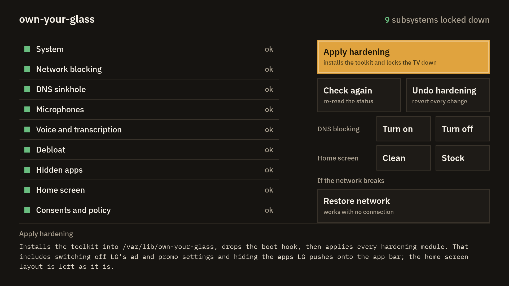
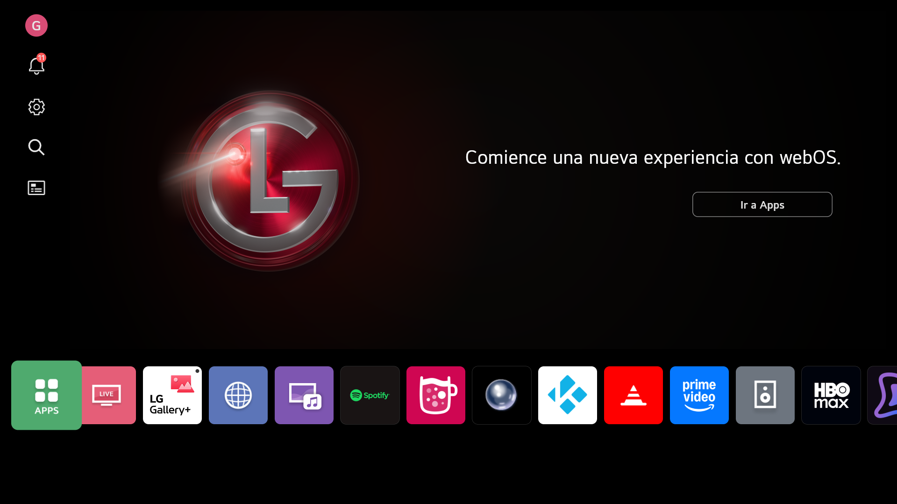

<p align="center">
  
</p>

# own-your-glass

> Harden a rooted LG webOS TV — kill the microphones, stop the screen-capture leak, block the ad/telemetry endpoints, and debloat the services you never asked for.


The name is a reminder: this tool helps you *own* the glass on your wall,
not the vendor's data pipeline. It does not turn the TV into a fortress.
It is a best-effort mitigation of the specific leaks found by your own
security investigation on your own rooted webOS TV.

Written in POSIX `sh` so it runs on the BusyBox shell that ships on the device.


<sub>The control panel running on the TV (LG OLED, webOS 10.3.2), captured from the device.</sub>


<sub>The home screen after <b>Home screen: Clean</b>: LG's banner, quick cards and recommendation shelves are gone, the banner area holds the own-your-glass wallpaper, and your apps sit along the bottom. Captured from the device.</sub>

---

## Contents

- [What it actually does](#what-it-actually-does)
- [Rooting your TV](#rooting-your-tv)
- [Quick start](#quick-start)
- [Control panel (the TV app)](#control-panel-the-tv-app)
- [Threat model](#threat-model)
- [Module table](#module-table)
- [How it works (the four techniques)](#how-it-works-the-four-techniques)
- [Install (on the TV)](#install-on-the-tv)
- [Warn-on-risk / opt-in flags](#warn-on-risk--opt-in-flags)
- [Limits](#limits)
- [Documentation](#documentation)
- [Attribution](#attribution)
- [License](#license)
- [Disclaimer](#disclaimer)

---

## What it actually does

- **Microphones**: every ALSA capture endpoint that can hear the room is neutralised (four on this TV). Playback and the internal loopbacks that carry Bluetooth A2DP and WOWCAST soundbar audio are left alone, so wireless audio keeps working.
- **Magic Remote mic + speech-to-text**: dead. The `voiceinput_hidraw` → `voiceinput` → `voiceconductor` pipeline is replaced with `/dev/null`; `/dev/hidraw0` stays alive so the rest of the remote still works.
- **Screen-capture leak** (`/tmp/capture.rgb`, readable by any app): closed. `/usr/bin/vtCaptureTestSuite` is bind-mounted over `/dev/null`; the capture file is `chattr`+`immutable`.
- **Ad / telemetry / ACR domains + ThinQ cloud + firmware-update servers**: blocked, dual-stack (IPv4 `0.0.0.0` **and** IPv6 `::1` per domain, because an IPv4-only sinkhole let AAAA lookups fall through to DNS).
- **LG consents**: force-declined and re-declined every boot (covers the system silently re-accepting them after a component update).
- **Ad / ACR / overlay / SDK-example apps**: hidden from the launcher via the vendor's own `blockedSystemAppList/<REGION>.json`.
- **Unused feature services and telemetry daemons**: stopped, including the usage logger (`service-logger`), the crash and analytics reporter (`rdxd`), the LG Channels beacon (`dmost`), the Alexa adapter (it kept a live session open even with the mic dead), family care and the LAN print server. Casting is left alone: AirPlay, Chromecast, Screen Share (Miracast), DLNA and DIAL keep working.
- **HbbTV and the phone remote**: HbbTV red-button apps (the source of most third-party trackers seen on the wire) are switched off, and the SSAP phone-remote API on port 3001 is closed to the LAN. LG's ad cookie is emptied.
- **DNS**: every lookup goes through the on-device sinkhole; resolv.conf no longer lists the ISP's server as a fallback. Three LG servers the TV contacts by IP address (update check, remote support) are blackholed too.
- **telnetd** (unauthenticated root on the LAN): disabled via `/var/luna/preferences/webosbrew_telnet_disabled`, which makes webOSbrew's `startup.sh` skip the `telnetd -l /bin/sh` launch.
- **Home screen** (opt-in): LG's ad, promotion, tips and sports-alert settings off; the apps LG pushes onto the app bar (Rakuten TV, LG Streaming Week, 8 Ball Pool, any stub) hidden with their quick cards; optionally the wallpaper layout shown above.

---

## Rooting your TV

`oyg` requires root. Rootability of a webOS TV is **firmware-version-specific** — what works on one build may be patched on the next. This project does not ship exploit code; find one that matches your model + firmware on the community sites below.

- **Compatibility checker:** <https://cani.rootmy.tv> (model + firmware → supported chains).
- **Community guide:** <https://www.webosbrew.org/rooting/> — the official rooting walk-through.
- **RootMyTV:** <https://rootmy.tv> — the original `GetMeNow` exploit. Patched on many recent models.
- **DejaVuln autoroot:** <https://github.com/throwaway96/dejavuln-autoroot> — webOS 3.5+. Other common chains: `faultmanager`, `GetMeNow`.
- **Research / kernel work:** <https://openlgtv.github.io>.

**Before you start**, uninstall LG's **Developer Mode** app if it is present. It conflicts with the rooting chain, and its functionality is replaced by Homebrew Channel once you are rooted.

**After rooting**, Homebrew Channel is installed automatically. In Homebrew Channel → Settings, **enable the SSH server**. **Leave Telnet off** — `telnetd` ships as an unauthenticated root shell on the LAN, and the [`policy` module](docs/DOCUMENTATION.md#consent--update-blocker-neutralisation-the-policy-module) maintains the flag that keeps it off.

**First login**, from your computer:

```sh
ssh root@<tv-ip>                       # default password: alpine
ssh-copy-id -i ~/.ssh/id_ed25519.pub root@<tv-ip>
```

The key lands at `/home/root/.ssh/authorized_keys` on the TV. Once that file exists, Homebrew Channel stops provisioning the `alpine` default password on subsequent boots, so do this immediately.

**Never flash the kernel, rootfs, or TVService.** See <https://rootmy.tv/warning>. `oyg` never writes a system partition; it only changes file modes on writable paths, bind-mounts, `ip route` entries, and service state.

**Warnings:**

- Rooting affects your warranty. That is between you and LG.
- A **factory reset can lose root** and may make re-rooting impossible on that unit — re-check `cani.rootmy.tv` for your firmware before doing either.
- The webOSbrew update-blocker flag (touched by the `policy` module) protects your root by sinkholing LG's update servers. It also stops LG kernel security patches from arriving. Pick your trade-off.

---

## Quick start

```sh
scp -r . root@<tv-ip>:/tmp/oyg && ssh root@<tv-ip> 'sh /tmp/oyg/install.sh'
ssh root@<tv-ip> '/var/lib/own-your-glass/oyg list'
ssh root@<tv-ip> '/var/lib/own-your-glass/oyg harden --dry-run'   # then drop --dry-run
```

After install, no hardening is applied yet — pick your modules and re-run with `--dry-run` removed. See [Install (on the TV)](#install-on-the-tv) below for the full flag set, including the opt-in aggressive modes.

---

## Control panel (the TV app)

`app/` is a webOS app that puts the toolkit on the remote. It carries its own copy of the
toolkit, so installing the app is all a TV needs. The screenshot at the top is the panel on a
real TV.

- **Status** comes from `scripts/status-fast.sh`, one row per subsystem. The focused row's
  individual checks show underneath.
- **Apply hardening** installs the bundled toolkit to `/var/lib/own-your-glass` and runs
  `oyg harden` with the network flags on (`OYG_NETWORK_BLOCK`, `OYG_NETWORK_STRICT`,
  `OYG_NETWORK_IPBLOCK`, `OYG_DNS_OVERRIDE`, `OYG_DNS_RESOLVER`) and `OYG_LAUNCHER=1` (LG's ad
  and promo settings off, pushed apps hidden; the home layout is left as it is). It also turns HbbTV
  and the SSAP phone remote off and stops the telemetry daemons listed above. That is
  stricter than a plain `oyg harden`; see [the opt-in flags](#warn-on-risk--opt-in-flags) for
  what each one can break.
- **Check again** re-reads the status. **Undo hardening** runs `oyg restore`.
- **DNS blocking — Turn on / Turn off** starts or stops the on-device sinkhole (`scripts/dns.sh`).
- **Home screen — Clean / Stock** switches the home to the wallpaper layout shown at the top
  (`OYG_LAUNCHER_TRIM=1`) or puts LG's layout back (`OYG_LAUNCHER_TRIM=0`). Clean is kept at
  every boot, and Apply hardening leaves whichever you picked alone.
- **Restore network** runs `scripts/recover-network.sh`, which puts networking back to stock
  and works with no connection.

Build it on your computer and install it through Homebrew Channel:

```sh
sh scripts/build-app.sh                            # writes dist/org.ownyourglass.control-<version>.ipk and prints its sha256
python3 -m http.server 8000 --directory dist       # serve it on your LAN

# then, in an SSH session on the TV:
luna-send -w 150000 -n 8 -f luna://org.webosbrew.hbchannel.service/install \
  '{"id":"org.ownyourglass.control","ipkUrl":"http://<computer-ip>:8000/org.ownyourglass.control-<version>.ipk","ipkHash":"<sha256>","subscribe":true}'
```

It prints progress until `"statusText": "Finished."`. If you run it as a one-shot
`ssh root@<tv-ip> '…'` instead, add `</dev/null` to the `luna-send` line; without a closed stdin
it exits silently and installs nothing.

Rebuild and reinstall the app whenever the toolkit changes: **Apply hardening** installs the
copy the app carries, so an old app puts old code back.

The icon is a three.js render; `design/icon/build.sh` regenerates `app/icon.png`,
`app/largeIcon.png` and the logo at the top of this page.

---

## Threat model

You own the device, it is rooted, but the vendor's data-collection
processes (ACR, content miner, object detection, ad overlay, telemetry
beacons, voice transcription, screen capture into app sandboxes,
RemoteOne remote-support gate, world-writable vendor service code paths)
keep running in the background and leak data to LG / cloud / AdTech.
This toolkit stops what it can, blocks what it can, and clearly documents
what it cannot.

It is **not** designed to defend against an attacker with root. Once
someone has root they can disable everything in this toolkit. The
defender-of-root is firmware integrity and boot-chain validation, which
this tool does not touch.

---

## Module table

| Module | Neutralises | Opt-in flag | Reversible? |
|---|---|---|---|
| `capture` | Screen-capture leak: `chattr`+`immutable` on `/tmp/capture.rgb`; `mount --bind /dev/null` on `/usr/bin/vtCaptureTestSuite` (read-only `/usr`) | none — safe by default | yes (`umount` + restore mode) |
| `mic` | Physical ALSA capture PCMs (`pcmC1D0c`, etc.): `chmod 000` + `mount --bind /dev/null`. Playback and internal loopbacks (`pcmC0D10c` BT A2DP, `pcmC0D14c` WOWCAST) untouched. | none — safe by default | yes |
| `voice` | Magic Remote mic pipeline: `chmod 000` + bind-null on `voiceinput_hidraw`, `voiceinput`, `voiceconductor`. `/dev/hidraw0` deliberately untouched (carries every other remote button). | none — safe by default | yes |
| `logs` | Periodic clear of `/tmp/var/log/messages` and `/tmp/app.voice.log` (damage limitation). | none — safe by default | yes (stop the watcher) |
| `remoteone` | Verifies `/mnt/lg/cmn_data/remoteDebug/` is absent; optionally tightens `cmn_data`. | `OYG_AGGRESSIVE=1` for the chmod step | yes |
| `policy` | Switches HbbTV off (with Do-Not-Track on and the HbbTV device ID off) and the SSAP phone-remote API off: LG's `allowMobileDeviceAccess` setting plus `only_from = 127.0.0.1` on xinetd's port 3001 entry (Job E); bind-mounts `/dev/null` over LG's ad cookie (Job F). Touches `/var/luna/preferences/webosbrew_block_updates` (webOSbrew fallback hosts-bind) and `webosbrew_telnet_disabled` (suppresses telnetd — unauthenticated root on the LAN); force-declines LG consents in **all four** on-disk consent stores — `/var/luna/preferences/eula` (Job B) plus the three SDX/ACR-side stores at `/mnt/lg/{cmn_data,cache,user}/sdp/eula-service/eula.json` (Job C, A→D for every `S_DPA`/`S_SVC`/`S_VNG`/`S_MKT`/`S_ADG`/`S_TAG`); moves `marketingAllowedDate.json` aside so the 2-year "re-allow marketing" toast never fires (Job D). All re-applied every boot. | `OYG_TOS_IDS="S_VNG S_TAG"` allow-list form (default = decline ALL — applies to Job B only); `OYG_POLICY_KEEP="hbbTV allowMobileDeviceAccess"` leaves Job E settings alone | yes (`restore` from `$OYG_BACKUP/eula.orig` + `eula-{cmn,cache,user}.orig` + `marketingAllowedDate.json.orig`; Job E settings back to their saved values; mounts undone) |
| `apps` | Hides a curated list (48 IDs) from the launcher via the vendor's own `blockedSystemAppList/<REGION>.json`. Ad machinery, remote-support tile, SDK examples, demo apps. Skips IDs absent on the device. | none — safe by default | yes (restore the original file from backup) |
| `debloat` | Stops + bind-nulls unused feature services and telemetry daemons: `mycar`, `familycare`, `buddyconnector`, `alwaysready`, `ai-inference-manager`, `avahi-daemon`, `avahi-adaptor`, `ruleengine`, `wowplay`, `service-logger`, `rdxd`, `dmost`, `ninfod`, `cups-lpd.socket`; bind-nulls `/usr/bin/com.webos.app.voice`, `iconnectivity`, `uploadd`, `sportsalarm`, `amazon-alexa-adapter`, `performer`, `nlpmanager`, familycare's `index.js` (dynamic LS2 — bind defeats respawn), plus `iot-client` when aggressive services are on. **`sdx` and `ss.gateway` are deliberately left alone**: neutralising `sdx` silently breaks the TV's Settings UI (F42), and `ss.gateway` hosts every JS service, DIAL included (F48). | none — on by default. It does switch features off: LG's WOW wireless-speaker sync for LG soundbars (`wowplay`), LG phone pairing, family care, AI inference, Alexa, sports alerts and the voice-app UI. AirPlay, Chromecast, Screen Share, DLNA and DIAL are untouched. `wowplay` stays stopped (`Type=static`); the rest are stopped again at every boot | yes |
| `network` | Four-layer mitigation: `/etc/hosts` bind-overlay (dual-stack IPv4+IPv6 sinkhole, always); blackhole public resolvers (always); per-IP blackhole (opt-in); on-device sinkhole resolver on `127.0.0.2:53` hooked in via a `/etc/resolv.conf` bind-mount (opt-in; the ConnMan route is rejected on this device — see scripts/dns.sh post-mortem). Always blocks LG firmware/update servers; with `OYG_NETWORK_STRICT=1` also blackholes three LG servers the TV reaches by hard-coded IP (update check, RemoteOne). | `OYG_NETWORK_BLOCK=1` (without it, layer 1 + layer 2 still applied); `OYG_NETWORK_STRICT=1`; `OYG_NETWORK_IPBLOCK=1`; `OYG_DNS_OVERRIDE=1`; `OYG_DNS_RESOLVER=1` | yes (`umount` + route delete + resolv.conf umount) |
| `launcher` | Clean home screen: LG ad / promo / tips / sports-alert settings off (`setSystemSettings`); pushed apps (every stub, Rakuten TV, LG Streaming Week, 8 Ball Pool) hidden from the app bar with their quick cards (`homelaunchpoints`); the server-written push list pruned to installed apps; with `OYG_LAUNCHER_TRIM=1`, the wallpaper layout: a `home.xml` without quick cards or shelves and with a taller hero, bind-mounted over the original, the wallpaper bind-mounted over the hero's built-in pictures, and the home restarted (all undone automatically if the home's layout parser reports an error). See F45, F50. | `OYG_LAUNCHER=1` (opt-in); `OYG_LAUNCHER_TRIM=1` for the layout; `OYG_LAUNCHER_WALLPAPER=<file>`; `OYG_LAUNCHER_KEEP="<id> ..."` | yes (settings, apps, quick cards, push list, layout and pictures all restored) |

Every module exposes:

- `mod_<name>_harden`   — apply, idempotent, reversible
- `mod_<name>_restore`  — undo
- `mod_<name>_status`   — print `OK|PARTIAL|FAIL|N/A <detail>`

`oyg verify` exits non-zero if any applied module is not in `OK` or `N/A`.

---

## How it works (the four techniques)

Everything in this toolkit is built from the same four low-level moves, because a rooted webOS TV gives you very few of them.

1. **`mount --bind /dev/null` over a device node or binary** (kills the *pipe*, not the driver).
   - Over an ALSA PCM like `/dev/snd/pcmC1D0c`: every `open()` returns `ENXIO` / "Inappropriate ioctl for device" — the kernel still owns the driver, the user-space consumer just cannot read from it.
   - Over a vendor binary like `/usr/bin/vtCaptureTestSuite` (which lives on a read-only `/usr`, so `chmod 000` fails): any `exec()` reads zeros and fails. Re-launchers hit the bind immediately on the next attempt.
2. **`mount --bind` a generated file over the read-only `/etc/hosts`** (LG already does this same trick for `/etc/shadow`).
   - The network module emits a hosts file from the blocklists at `/var/lib/own-your-glass/hosts` and bind-mounts it over `/etc/hosts`. Dual-stack: every blocked domain gets **both** `0.0.0.0 <d>` and `::1 <d>` — an IPv4-only sinkhole lets AAAA lookups fall through to DNS.
3. **`systemctl stop` + re-stop from an `/var/lib/webosbrew/init.d` hook**.
   - Because `/etc` is a read-only overlay on this device, `systemctl mask` is impossible (mask writes to `/etc/systemd`). So the model is: stop now, then stop again on every boot. The init.d hook reads two flat files (`services.stopped`, `services.kill`) and re-applies them after the network wait.
4. **`ip route add blackhole`** for hardcoded public resolvers (because netfilter does not exist on this SoC).
   - `iptables` is non-functional (`ip_tables` kernel module absent), `nft` is not present, `tc` returns `RTNETLINK answers: Operation not supported`. The network module's layer 2 blackholes `8.8.8.8 / 8.8.4.4 / 1.1.1.1 / 1.0.0.1 / 9.9.9.9 / 208.67.222.222 / 208.67.220.220` so daemons that bypass `/etc/hosts` by talking to a hardcoded resolver IP are still cut.

---

## Install (on the TV)

Pick whichever path is easier. **(A)** runs entirely on the TV; **(B)** lets you review the repo on your computer first.

**(A) One-liner — run ON the TV.** The TV's BusyBox + webOS userland ships `curl`, `wget`, `tar`, `gzip`, and `unzip`, and can reach GitHub over TLS. After rooting and installing your SSH key:

```sh
ssh root@<tv-ip>
curl -fsSL https://github.com/JulioFerrero/own-your-glass/archive/refs/heads/main.tar.gz \
  | tar xz -C /tmp \
  && sh /tmp/own-your-glass-main/install.sh
```

Tarballs from `archive/refs/heads/main.tar.gz` extract to `own-your-glass-main/` — use that exact path. If `curl` misbehaves, the same flow works with `wget`:

```sh
wget -qO- https://github.com/JulioFerrero/own-your-glass/archive/refs/heads/main.tar.gz \
  | tar xz -C /tmp \
  && sh /tmp/own-your-glass-main/install.sh
```

**(B) From your computer** — `git clone` then serve the tree to the TV any way you like (scp to `/tmp/own-your-glass` and run `install.sh` there works; the control-panel app does this for you from its bundled copy).

Either path installs to:

- `/var/lib/own-your-glass/`        — the toolkit root (state, backups, log, watchers)
- `/var/lib/webosbrew/init.d/oyg`   — boot hook (re-applies safe modules; `run-parts` ignores dotfiles, so no `.sh` suffix)

`install.sh` only copies files and drops the boot hook — **nothing is hardened until you run `oyg harden`** below.

After install, inspect what is available, dry-run, apply, then verify:

```sh
ssh root@<tv-ip> '/var/lib/own-your-glass/oyg list'
ssh root@<tv-ip> '/var/lib/own-your-glass/oyg harden --dry-run'   # review
ssh root@<tv-ip> '/var/lib/own-your-glass/oyg harden'             # apply the safe set
ssh root@<tv-ip> '/var/lib/own-your-glass/oyg verify'
```

Pick your modules (the rest of the flag set is unchanged from before):

```sh
# Always safe, no flags:
/var/lib/own-your-glass/oyg harden

# Dry-run first:
/var/lib/own-your-glass/oyg harden --dry-run

# Risky — break ThinQ/Home if applied:
OYG_AGGRESSIVE=1 /var/lib/own-your-glass/oyg harden --only services
OYG_AGGRESSIVE=1 /var/lib/own-your-glass/oyg harden --only perms

# Risky — may break apps/updates:
OYG_NETWORK_BLOCK=1 /var/lib/own-your-glass/oyg harden --only network
# Even riskier — also blocks ThinQ / voice / AI / LG control plane:
# OYG_NETWORK_BLOCK=1 OYG_NETWORK_STRICT=1 /var/lib/own-your-glass/oyg harden --only network
# Also enable per-IP blackhole (layer 3, ages as CDNs rotate):
# OYG_NETWORK_BLOCK=1 OYG_NETWORK_IPBLOCK=1 /var/lib/own-your-glass/oyg harden --only network
# Also rewrite /var/lib/misc/resolv.conf with the default gateway as nameserver:
# OYG_NETWORK_BLOCK=1 OYG_DNS_OVERRIDE=1     /var/lib/own-your-glass/oyg harden --only network
# Recommended — also install the on-device sinkhole resolver and hook it
# in via a /etc/resolv.conf bind-mount (layer 4, closes the connman-bypass
# gap verified on this device — see F14g in docs/FINDINGS.md; the ConnMan
# route itself is rejected, see the post-mortem in scripts/dns.sh):
# OYG_NETWORK_BLOCK=1 OYG_DNS_RESOLVER=1 /var/lib/own-your-glass/oyg harden --only network

# Verify everything is applied:
/var/lib/own-your-glass/oyg verify
```

Restore everything to the original state:

```sh
sh uninstall.sh
```

(or `/var/lib/own-your-glass/oyg restore` if you want to keep the
tool installed but undo the hardening.)

---

## Warn-on-risk / opt-in flags

The default `oyg harden` is conservative. The following flags unlock
risky behaviour. **Read the linked findings in `docs/FINDINGS.md` first.**

| Flag | Effect | What can break |
|------|--------|----------------|
| `OYG_AGGRESSIVE=1` (services) | also stops `iot-client` + `pushclient` (luna-launched AWS IoT MQTT + LG push channel; `systemctl stop` is a no-op for the actual process, so the module `kill`s it and re-kills on every boot) | ThinQ app, voice control, push notifications; may be re-spawned on demand by `ls-hubd` (boot hook is best-effort, not permanent) |
| `OYG_AGGRESSIVE=1` (perms) | chmods webOSbrew hbchannel + Google Home runtime | webOSbrew updates, Google Home on TV |
| `OYG_AGGRESSIVE=1` (remoteone) | chmods `/mnt/lg/cmn_data` from 0777 to 0755 | vendor apps that rely on that directory being world-writable |
| `OYG_TOS_IDS="S_VNG S_TAG"` (policy) | allow-list for the consent-decline step: only the named `"id"` entries are force-declined; default is decline ALL | depends on which ids you include |
| `OYG_NETWORK_BLOCK=1` | applies layers 1 + 2 (bind-mount hosts file + blackhole public resolvers) | apps, EPG, SmartShare, firmware updates — anything resolving via libc |
| `OYG_NETWORK_STRICT=1` | includes the STRICT blocklist section | ThinQ app, voice control, push notifications, LG home-screen card delivery |
| `OYG_NETWORK_IPBLOCK=1` | also applies layer 3 (per-IP `ip route add blackhole`) | anything whose IPs happen to be near the listed hosts (CDNs change!) |
| `OYG_DNS_OVERRIDE=1` | backs up `/var/lib/misc/resolv.conf` and writes `nameserver <default-gw>` | any DNS consumer that does NOT honour `/etc/hosts` (e.g. `nslookup`, some webOS daemons) |
| `OYG_DNS_RESOLVER=1` (network, layer 4) | installs an on-device DNS sinkhole resolver (UDP + TCP, pure Python stdlib) and hooks it in via a **`/etc/resolv.conf` bind-mount**: the managed file lists only the sink (`OYG_DNS_FALLBACK=1` adds the real DHCP-learned upstream as a second nameserver, as older versions did; see F47). The resolver is started and verified answering BEFORE the override goes in; an auto-revert timer (180 s) unmounts an unconfirmed apply. Substring/suffix-match covers subdomains in one rule. Watchdog re-asserts resolv.conf and reverts the override if the resolver dies and won't restart. The bind address comes from `$OYG_ROOT/dns.bind` (`127.0.0.2` by default; `127.0.0.1` under Variant C — see F44). | anything that resolves through `/etc/resolv.conf` (libc `getaddrinfo`, most daemons) and `nslookup`/BusyBox resolution. The ConnMan *settings* route is **rejected on this device**: editing connman's settings + nudging connmand (no `ExecReload` → SIGHUP) took the TV off the network for ~30 min, so this toolkit NEVER signals, reloads or restarts connmand (see the post-mortem in `scripts/dns.sh`). The launcher-patch route (`scripts/go-c.sh`, `-r --nodnsproxy`) is the supported way to close the loopback path. Worst-case rollback is `umount` — the TV falls back to ConnMan's own resolv.conf. With the sink as the only nameserver, a dead resolver means failed lookups until the watchdog restarts it or reverts the override (15 s checks). |
| `OYG_LAUNCHER=1` (launcher) | turns LG's ad / promotion / Smart Tips / sports-alert / Live Plus settings off and limit-ad-tracking on, hides the apps LG pushes (stubs, Rakuten TV, LG Streaming Week, 8 Ball Pool) with their quick cards, and prunes the push list | those LG features; Rakuten TV is hidden too (`OYG_LAUNCHER_KEEP="ui30"` keeps it) |
| `OYG_LAUNCHER_TRIM=1` (launcher) | also switches the home to the wallpaper layout (quick cards and recommendation shelves removed, the banner area grown into a wallpaper, apps docked below; bind-mounted `home.xml` and pictures, home restarted); or a list of item IDs to hide instead, e.g. `"herobanner qcardList recommendedShelf"` for the black minimal layout; `0` puts the stock layout back | the "Recent inputs" and tips rows go with the shelves; use the Live TV tile or the input button instead |
| `OYG_LAUNCHER_WALLPAPER=<file>` (launcher) | uses your own picture for the wallpaper layout (PNG; any size, it is scaled to cover 3492x1450); `default` goes back to the toolkit's | nothing |

---

## Limits

This is mitigation, not a fortress. In short:

- **No firewall.** The kernel has no netfilter, so there are no port rules; specific IPs are
  blackholed with `ip route` instead.
- **No DoH / DoT blocking on the TV.** A daemon that resolves over HTTPS (443) or TLS (853) gets
  past the sinkhole. Block those at your router: see
  [router-level enforcement](docs/DOCUMENTATION.md#router-level-enforcement-the-real-fix-for-the-resolver-bypass-gap).
- **`/etc` and `/usr` are read-only**, so services are stopped again on every boot rather than
  masked, and vendor binaries are bind-mounted over rather than edited.
- **Nothing here stops someone with root**, or a firmware update. The kernel, firmware and boot
  chain are never touched.
- **The hardware still hears the room.** Neutralising the capture devices makes the audio
  unreadable to user-space programs; it does not switch the microphones off.

The full list, with how each limit was verified, is in
[What this CANNOT do on this device](docs/DOCUMENTATION.md#what-this-cannot-do-on-this-device).

---

## Documentation

- [docs/DOCUMENTATION.md](docs/DOCUMENTATION.md) — the reference: each module in depth (network, debloat, apps, launcher, `mic`,
  `voice`, `policy`), what the TV cannot do, router-level enforcement, watching the TV's
  traffic, `oyg list`, the file layout and boot persistence.
- [docs/FINDINGS.md](docs/FINDINGS.md) — every finding from the investigation, mapped to the
  module that addresses it and how well.
- [docs/VERIFICATION-REPORT.md](docs/VERIFICATION-REPORT.md) — the independent verification
  report on the TV (redacted for publication).

---

## Attribution

This toolkit builds on the work of others. Specific credit:

- **Blocklist** — `etc/blocklist-upstream-safe.txt` is a vendored snapshot of
  [furkan-bayrak/lg-tv-blocklist](https://github.com/furkan-bayrak/lg-tv-blocklist),
  retrieved 2026-09-14. The upstream list is licensed **CC BY 4.0**;
  attribution to the upstream author is preserved in the file's header.
  Refresh with `scripts/refresh-blocklist.sh` (always off-device).
- **Rooting** — webOSbrew / rootmy.tv provide the homebrew channel used
  to gain the root access this toolkit assumes you already have.

---

## License

This project — code, configuration, and prose — is released under the
**MIT License**. See the [`LICENSE`](./LICENSE) file at the repository root.

The vendored blocklist *data* in `etc/blocklist-upstream-safe.txt` is a
snapshot of upstream work and **remains under its original CC BY 4.0
license**; attribution to the upstream author is preserved in the
file's header and must be carried with any redistribution of the
blocklist contents.

---

## Disclaimer

- **Never flash the kernel or rootfs.** See the upstream rootmy.tv
  warning — flashing system partitions can permanently brick the
  device. This tool does not flash anything and never writes a system
  partition; it only bind-mounts over user-writable paths (or vendor
  paths that `mount --bind` can legally target) and stops processes.
- **Everything is reversible.** `oyg restore` (or `uninstall.sh`) puts
  the device back to the pre-install state.
- **For hardware you own.** Root access and OS-level hardening are
  legitimate on a device you own, but may void your warranty and may
  violate terms of service in your jurisdiction. Run at your own risk.
- **Not a root-level defence.** Anyone with root on the device can
  undo every change here in seconds. The defender-of-root is firmware
  integrity and boot-chain validation, which this tool does not touch.
